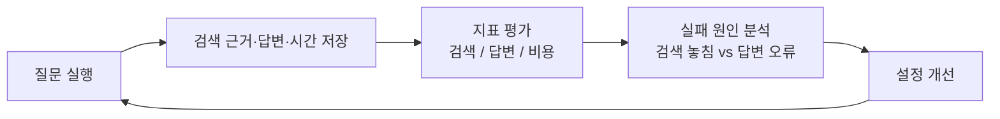
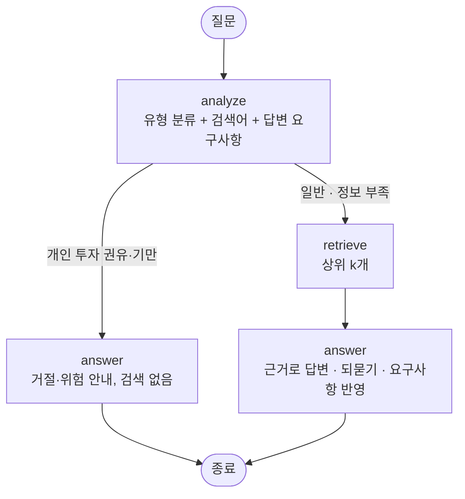
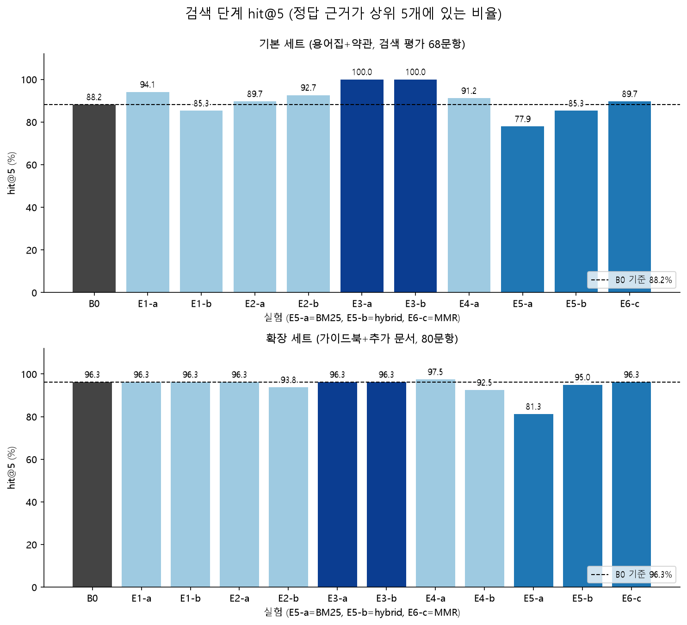
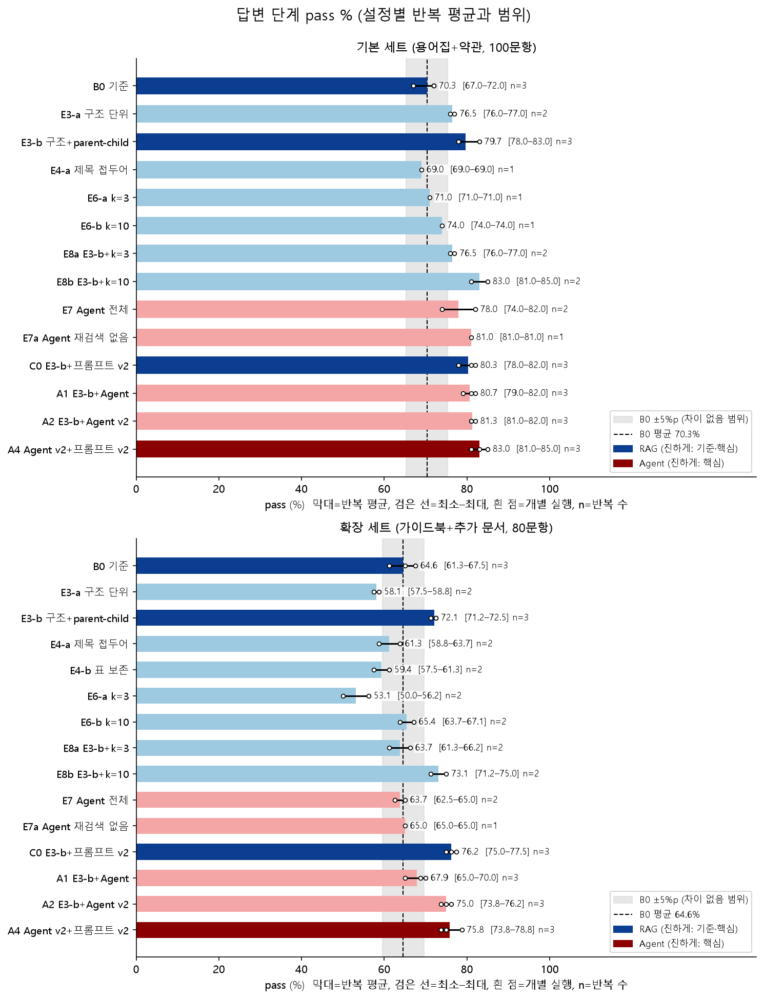
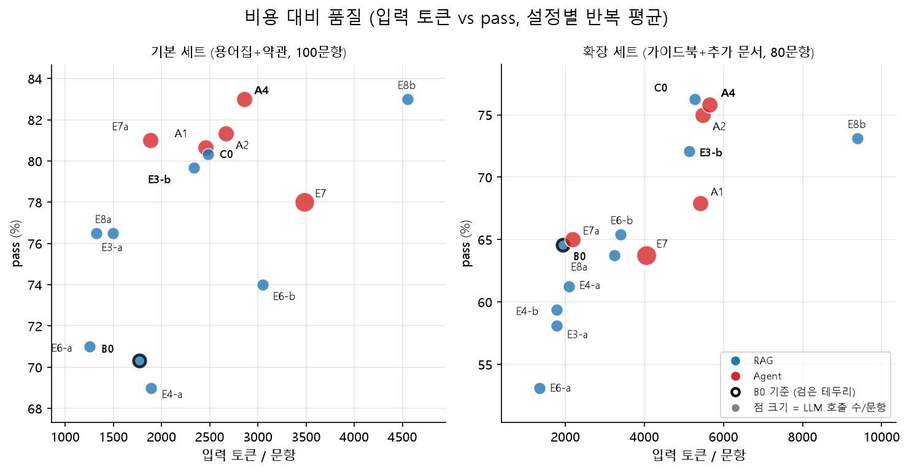
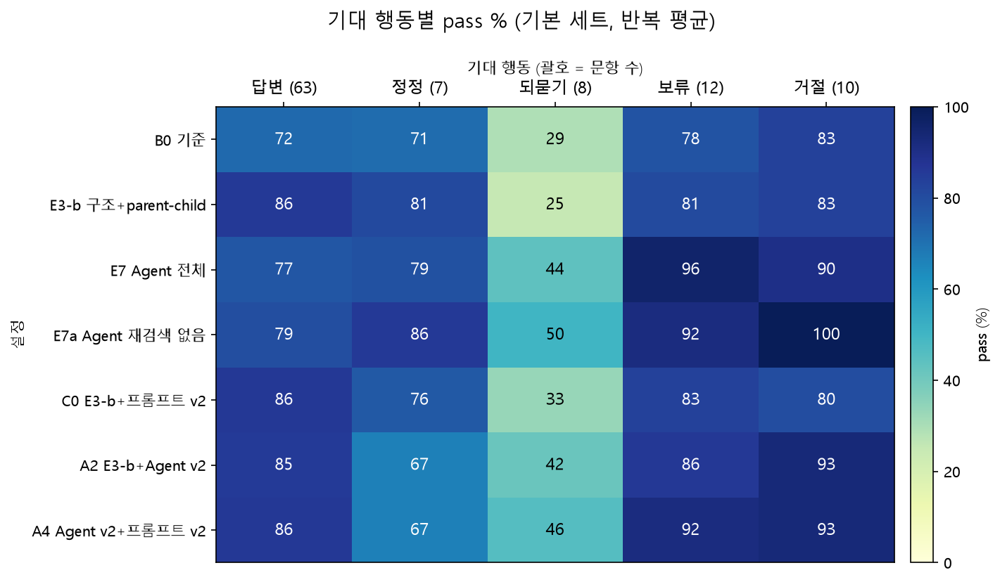

# 금융 문서 기반 RAG Agent 구현 실습

## 📄 문서 안내와 실행 방법

### 1. 문서

| 문서 | 내용 |
|---|---|
| `experiment_plan.md` | 실험 계획: 평가 세트, 기준 설정(B0), 지표, 비교 실험(E1~E8) 가설, 최종 설정 선택 기준, 진행 순서 |
| `experiment_results.md` | 실험 결과: 검색 단계·답변 단계 표, 아이디어별 해석, 실패 사례 분석, 잠정 선택, 한계 |
| `experiment_results_emb2.md` | 같은 실험을 임베딩 gemini-embedding-2로 다시 돌린 결과와 001 비교(결과 `results_emb2/`, 표는 `rag/compare_embeddings.py`). 환경변수 `EMBEDDING_MODEL`·`CHROMA_DIR`·`RAG_RESULTS_DIR`만 바꾸면 같은 명령으로 재현 |
| `make_figures.py`, `img/` | README의 결과 그래프(PNG 4장)와 이를 만드는 스크립트(`python docs/make_figures.py`) |
| `experiment_results_agent_v2.md` | E3-b 위에서 Agent를 개선한 실험(A1·A2·A3, 프롬프트 대조군 C0): 결과, 해석, Agent 구성 판단. 옵션 `--agent-options v2=1,analyze_model=...`, `--rag-prompt v2` |
| `chatbot/` | 사용자가 문서에 대해 질문하는 챗봇(streamlit). 백엔드 `chatbot/core.py`(최종 설정), 화면 `chatbot/app.py`. 실행은 README '챗봇으로 질문하기' |
| `dashboard/` | 평가 결과 대시보드(streamlit). 개요·검색 단계·답변 비교·비용 대비 품질·반복 오차·문항 탐색·임베딩 비교 탭. 실행은 아래 '결과 보기' |
| `experiment_records.md` | 결과를 어떻게 저장·비교하는지: 폴더 구조, config·문항별 결과 스키마, 지표 정의, 비교 도구 |
| `agent_graph.md` | Agent(검색 재시도형) 그래프 구조도: 노드, 분기, 종료 조건, 요소 끄기(ablation) |
| `progress.md` | **진행 기록**: 끝낸 것, 결론, 남은 것, 평가를 더 돌릴 때 |
| `answer_tables.md` | 답변 단계 설정별 결과 표(`python -m rag.report --md`로 생성) |
| `plan_extract_p4l_fixes.md` | PDF → md 추출 개선 계획(추출 단계 기록) |

### 2. 코드 구성

| 파일 | 역할 |
|---|---|
| `extract/` | PDF → md 추출(pymupdf4llm, 표·그림은 vision 모델) |
| `rag/md_parser.py`, `rag/doc_chunking.py`, `rag/chunking.py` | md 읽기와 청킹 전략(Recursive, 구조 단위, parent-child, 제목 접두어, 표 보존) |
| `rag/build_index.py`, `rag/chroma_store.py`, `rag/pg_store.py` | 색인: 청크는 Chroma, parent 원문은 Postgres |
| `rag/retrievers.py`, `rag/search.py` | 검색(similarity, MMR, BM25, hybrid), 터미널 시험 |
| `rag/evaluate.py` | 검색 단계 평가 |
| `rag/rag.py`, `rag/agent.py`, `rag/llm.py` | 기본 RAG, Agent, Gemini 호출(재시도·차단 처리·LangSmith 추적) |
| `rag/judge.py`, `rag/answer_eval.py` | 답변 판정, 답변 단계 평가(RAG·Agent) |
| `rag/experiment.py` | 실험 기록 공통 코드 |
| `rag/compare.py`, `rag/report.py`, `rag/failure_analysis.py`, `rag/human_sheet.py` | 비교, 반복 평균 집계, 실패 분류, 사람 대조 시트 |

### 3. 준비

- 상위 폴더 `.env`에 `GOOGLE_API_KEY`, `POSTGRES_*`, `RAG_POSTGRES_DB`, `CHROMA_DIR`, (선택) `LANGSMITH_*`를 둔다.
  Chroma는 경로에 한글이 있으면 1,000개 넘는 컬렉션의 인덱스를 못 쓰므로 `CHROMA_DIR`는 한글이 없는 경로(예: `C:/rag_data/chroma_db`)여야 한다.
- `pip install -r requirements.txt`, Postgres 실행.

### 4. 색인 만들기 (컬렉션)

```bash
# 기준 B0: 문서 전체를 Recursive 500/50으로
python -m rag.build_index --doc-type standard_terms glossary --strategy recursive --collection base_rec_c500_o50
python -m rag.build_index --doc-type life_guide additional_p4l --strategy recursive --collection extended_rec_c500_o50
# 구조 단위 / parent-child / 제목 접두어 / 표 보존
python -m rag.build_index --doc-type standard_terms glossary --strategy structure --collection base_struct_c500_o50
python -m rag.build_index --doc-type standard_terms glossary --strategy parent-child --collection base_pc_c500_o50
python -m rag.build_index --doc-type standard_terms glossary --strategy recursive --title-prefix --collection base_rec_title_c500_o50
python -m rag.build_index --doc-type life_guide additional_p4l --strategy recursive --table-aware --collection extended_rec_table_c500_o50
```

### 5. 평가 실행

```bash
# 검색 단계(기준 실험 → 비교 실험은 --baseline)
python -m rag.evaluate --name B0-base --collection base_rec_c500_o50 --methods similarity
python -m rag.evaluate --name E5-base --collection base_rec_c500_o50 --methods bm25 hybrid --baseline <B0 실험 ID>

# 답변 단계: 기본 RAG, Agent, k 변경, Agent 요소 끄기
python -m rag.answer_eval --name B0-base --collection base_rec_c500_o50
python -m rag.answer_eval --name E3-b-base --collection base_pc_c500_o50 --baseline <B0 실험 ID>
python -m rag.answer_eval --name E6-a-base --collection base_rec_c500_o50 --baseline <B0 실험 ID> --k 3
python -m rag.answer_eval --mode agent --name E7-base --collection base_rec_c500_o50 --baseline <B0 실험 ID>
python -m rag.answer_eval --mode agent --agent-options retry=0 --name E7a-base --collection base_rec_c500_o50 --baseline <B0 실험 ID>

# 시험 실행(앞 5문항, 정식 기록과 따로 저장)
RAG_RESULTS_DIR=/tmp/trial python -m rag.answer_eval --name smoke --collection base_rec_c500_o50 --limit 5
```

답변 평가 한 번은 기본 세트 약 7분, 확장 세트 약 6분(문항 6개 동시 처리)이다. 판정 대기가 대부분이라 `--workers 16`으로 올리고 여러 평가를 동시에 돌리면 더 빠르다(응답 시간 열은 동시 처리 수가 다르면 비교할 수 없다). 문항 하나가 15분 안에 끝나지 않으면 오류로 기록하고 넘어간다.

### 6. 결과 보기

```bash
streamlit run dashboard/app.py            # 대시보드(results/, results_emb2/를 읽기만 한다)
python -m rag.report                      # 설정별 평균과 [최소–최대]
python -m rag.report --runs               # 설정별 실험 ID
python -m rag.compare --baseline-of <ID>  # 기준 대비 차이
python -m rag.failure_analysis <ID>       # 실패 원인 분류
python -m rag.human_sheet make <기본 B0 ID> <확장 B0 ID>   # 사람 대조 시트
python -m rag.human_sheet compare         # 채점한 시트와 판정 모델의 일치율
```


## 📜 구현 요약 (이 저장소의 결과)

더 자세한 내용
→ [`docs/experiment_plan.md`](docs/experiment_plan.md)(평가 계획), [`docs/experiment_results.md`](docs/experiment_results.md)(결과), [`docs/agent_graph.md`](docs/agent_graph.md)(Agent 구조), [`docs/experiment_records.md`](docs/experiment_records.md)(결과 기록 방식)

### 한눈에 보기

- **무엇을 했나:** PDF 23개를 Markdown으로 추출 → 청킹·색인 → 검색 평가(실행 35개) → 기본 RAG·Agent 답변 평가(실행 73개) → Agent 개선. 임베딩을 바꿔 다시 돌린 실험 61개는 별도로 기록했다.
- **가장 큰 결론:** 성능을 가장 크게 좌우한 것은 **청킹**이다. 문서 구조 단위로 자르고 부모 문서를 돌려주는 `E3-b`가 pass를 기본 세트 70.3 → 79.7%, 확장 세트 64.6 → 72.1%로 올렸다.
- **Agent:** 직접 설계한 Agent(질문 분석 → 검색 → 답변)를 개선(`A4`)했다. 품질 이득은 오차 범위이고 호출은 2배지만, 되묻기·보류·거절 같은 **행동 판단**이 좋아졌다.
- **결과 보기:** 대시보드(`streamlit run`)에서 그래프로 본다(아래).

### 1. PDF 추출 방법

PDF의 성격에 따라 두 경로로 Markdown(`md/`)을 만들었다. 모든 쪽에 `<!-- page: N -->` 표시를 남겨 **근거의 파일명·쪽**을 되짚을 수 있게 했다.

| 대상 | 스크립트 | 방법 |
|---|---|---|
| 표준약관 15개, 용어집 | `extract/extract_terms.py` | `pymupdf4llm`으로 글 위주 문서를 쪽 단위 Markdown으로 변환 |
| 가이드북, 추가 문서 6개(표·그래프가 많음) | `extract/extract_p4l.py` | 아래 5가지를 더한 추출 |

가이드북·추가 문서에서 더한 처리:

1. **표:** 자체 표 로더(`extract/tables.py`)가 병합 칸을 채우고 여러 줄 머리글을 한 줄로 합친다. 검사(열 이름 중복·빠진 글자 등)에 걸린 표는 표 이미지를 **Gemini 비전**으로 다시 읽는다. 칸 색칠로 기간을 나타낸 표는 색 사각형 좌표로 읽는다.
2. **그래프·인포그래픽:** 쪽을 이미지로 만들어 Gemini 비전이 읽고, `[graph]`·`[image]` 블록으로 본문에 붙인다. 그림은 잘라 `md/**/images/`에 저장한다.
3. **2단 문서:** 레이아웃 상자를 '왼쪽 단 → 오른쪽 단' 순서로 다시 놓아 문장이 섞이지 않게 한다.
4. **띄어쓰기:** 줄바꿈으로 갈라진 한글 말과 붙어 버린 문장을 형태소 분석기(Kiwi)로 정리한다. 글자는 바뀌지 않는다는 검사를 통과한 줄만 적용한다.
5. **블록 표시:** `<!-- block: table|graph|text page=N source=… -->`로 블록 종류·쪽·출처를 남겨 청킹 때 메타데이터로 쓴다. Gemini 응답은 해시로 캐시해 다시 돌려도 비용이 들지 않는다.

### 2. 평가 계획

비교 실험은 **기준 설정(B0)에서 한 번에 한 요소만** 바꾸고, 질문 세트·판정 방법은 고정한다. 자세한 계획은 [`docs/experiment_plan.md`](docs/experiment_plan.md), 결과 기록 방식은 [`docs/experiment_records.md`](docs/experiment_records.md).

| 항목 | 내용 |
|---|---|
| 평가 세트 | **기본**: 용어집+약관, 답변 100문항(검색 68). **확장**: 가이드북+추가 문서, 80문항. 세트끼리는 지표를 비교하지 않는다 |
| 기준 B0 | Recursive 500/50 청킹, 유사도 검색, `k=5`, `gemini-embedding-001`, 생성 `gemini-3.8-flash`(temperature 0) |
| 판정 | `gemini-2.5-pro`가 핵심 항목 포함·금지 내용·근거 준수·행동(답변/정정/되묻기/보류/거절)을 채점(생성 모델과 다르게) |
| 오차 | 같은 설정을 3회 돌려 흔들림을 쟀다. **pass 5%p, 핵심 항목 포함 3%p 안쪽은 '차이 없음'** |



| 실험 | 바꾼 요소 | 확인한 것 |
|---|---|---|
| E1·E2 | 청크 크기(300·800), 겹침(0·100) | 근거가 잘리는가, 불필요한 내용이 섞이는가 |
| E3-a·E3-b | 문서 구조 단위(조항·용어·제목), 부모 문서 반환(parent-child) | 근거 단위와 청크 단위를 맞추면 나아지는가 |
| E4 | 제목 접두어, 표 보존 | 문맥 보존이 답변을 바꾸는가 |
| E5 | BM25, hybrid | 용어형·상황형 질문에 맞는 검색 방식 |
| E6·E8 | 검색 개수 k(3·10), MMR | 근거 양과 중복·비용 |
| E7 | 기본 RAG → Agent, 요소별 끄기 | Agent의 효과와 비용 |
| A1~A4, C0 | Agent 개선, 프롬프트 개선 대조군 | 개선이 Agent 때문인지 프롬프트 때문인지 |

지표는 **검색**(hit·recall·source_coverage·중복), **답변**(핵심 항목 포함, pass, 근거 준수, 인용, 행동 일치), **비용**(토큰·LLM 호출·응답 시간)이다.

**Agent 구조 (A4)** — 구조도: [`docs/agent_graph.md`](docs/agent_graph.md)



### 3. 결과

> 아래 그림은 모두 `gemini-embedding-001` 결과(같은 설정 반복 평균)다. 그림은 `python docs/make_figures.py`로 다시 만든다.

**청킹이 검색을 가장 크게 바꿨다.** 기본 세트에서 구조 단위 청킹(E3-a·E3-b)은 hit@5가 0.88에서 1.00이 되었고, BM25만 나빠졌다.



**답변도 같은 방향이다.** `E3-b`(부모 문서 반환)가 두 세트에서 오차를 넘어 좋아졌다. 점선·회색 띠는 B0와 '차이 없음' 범위다.



**Agent는 비용이 크고 이득은 행동 판단에서 나온다.** 오른쪽 위가 좋다(적은 토큰, 높은 pass). 원래 Agent(`E7`)는 토큰이 B0의 약 2배인데 pass는 `E3-b`보다 낮다. 개선한 `A4`는 호출 2회로 비용을 줄였다.



**Agent의 강점은 되묻기·보류·거절이다.** `E3-b`는 답할 수 있는 질문(답변 86%)에는 강하지만 되물어야 할 질문(25%)에 약하다. `A4`는 그 약점을 메운다(46%).



| 설정 | 기본 pass % | 기본 핵심 포함 % | 확장 pass % | 확장 핵심 포함 % | LLM 호출 | 비고 |
|---|---|---|---|---|---|---|
| B0 기준 | 70.3 | 89.7 | 64.6 | 82.9 | 1 | Recursive 500/50 |
| **E3-b** | 79.7 | 94.5 | 72.1 | 89.0 | 1 | 구조 단위 + parent-child |
| E8a (E3-b, k=3) | 76.5 | 92.4 | 63.7 | 85.6 | 1 | 기본 세트의 비용 절감안(토큰 B0의 0.84배) |
| E7 Agent | 78.0 | 93.0 | 63.7 | 85.6 | 3 | 토큰 B0의 약 2배, 이득 제한적 |
| C0 프롬프트 v2 | 80.3 | 94.6 | **76.2** | 90.2 | 1 | Agent 없이 지침만 추가 |
| **A4 Agent v2 + 프롬프트 v2** | **83.0** | 94.9 | 75.8 | 89.2 | 2 | 선택한 Agent 구성 |

**최종 선택**

- **검색·청킹:** 두 세트 모두 `E3-b`(구조 단위 parent-child, `k=5`). 비용을 줄이려면 기본 세트에서 `E8a`(`k=3`).
- **Agent:** `A4`(질문 분석 + 답변 요구사항, 재검색 없음). 품질 이득은 오차 범위(기본 +3.3%p, 확장 +3.7%p)지만 되묻기·보류·거절이 좋아졌다. 비용 대비로는 `C0`(Agent 없는 프롬프트 개선)이 더 낫다는 점도 결과 문서에 적었다.
- **임베딩:** `gemini-embedding-001` 유지. `gemini-embedding-2`는 질의·문서 구분(`task_type`)을 무시해서 접두어 없이 쓰면 B0 hit@5가 0.88에서 0.69로 떨어졌다(접두어를 넣은 재실험은 하지 않았다).
- **한계:** 문항이 100·80개라 단일 실행은 ±5%p 안팎으로 흔들린다. 판정 모델의 사람 대조(20문항)와 직접 만든 골든셋은 하지 못했다.

상세 결과와 해석: [`docs/experiment_results.md`](docs/experiment_results.md)(기본 평가), [`docs/experiment_results_agent_v2.md`](docs/experiment_results_agent_v2.md)(Agent 개선), [`docs/experiment_results_emb2.md`](docs/experiment_results_emb2.md)(임베딩 비교).

### 4. 대시보드로 결과 보기

개요·검색 단계·답변 비교·비용 대비 품질·반복 오차·문항 탐색·임베딩 비교 탭이 있고, 두 임베딩 결과를 사이드바에서 고른다. 문항 탐색에서는 두 설정의 같은 문항을 질문·답변·컨텍스트·판정까지 나란히 볼 수 있다.

```bash
pip install -r rag_mini_project/requirements.txt
```

```bash
streamlit run rag_mini_project/dashboard/app.py
```

위 명령은 저장소 루트(`rag-mini-project/`)에서 실행한다. `rag_mini_project/` 안에서는 `streamlit run dashboard/app.py`이다. 결과 폴더(`results/`, `results_emb2/`)를 읽기만 한다.

### 5. 챗봇으로 질문하기

문서에 대해 직접 물어볼 수 있는 챗봇이다. 질문하면 PDF 23개에서 근거를 찾아 한국어로 답하고, **근거의 파일명·쪽과 원문**을 함께 보여 준다. 최종 설정(구조 단위 parent-child 검색 + Agent v2)을 그대로 쓴다.

```bash
streamlit run rag_mini_project/chatbot/app.py
```

- 질문 유형에 따라 Agent가 다르게 움직인다: 일반 질문은 근거와 함께 답하고, 정보가 빠진 질문(예: "이 계좌는 배우자가 이어받을 수 있어?")은 필요한 정보를 되묻고, 종목 추천 같은 투자 권유는 거절하고 위험을 안내한다.
- 답변의 `[1]` 같은 번호는 "근거 보기"의 항목 번호다. 인용된 근거와 검색만 된 근거를 구분해서 보여 준다.
- 준비물: Postgres 실행, 상위 폴더 `.env`(API 키, DB, `CHROMA_DIR`), 색인된 컬렉션(`base_pc_c500_o50`, `extended_pc_c500_o50`).
- 한계: 각 질문을 독립적으로 처리한다(앞선 대화를 기억하지 않는다). 평가에서는 기본·확장 문서 묶음을 따로 검색했지만 챗봇은 합쳐서 검색한다(합친 조건은 평가하지 않았다). 답변 한 번에 약 5~9초 걸린다(모델 호출 2회).

## 📓 실습 회고

### 1. 잘 된 것

- 기준(B0)을 먼저 정하고 한 요소만 바꿔서, 결과 차이를 원인 하나에 연결할 수 있었다.
- 같은 설정을 반복해 평가 오차(pass ±4~6%p)를 쟀고, 그 안쪽 차이를 효과로 착각하지 않았다.
- 기록을 실험 ID로 연결하고 기준 대비 바뀐 설정을 자동으로 남겼다.

### 2. 문제점과 개선 방안

| 항목 | 문제 | 원인 | 해 본 것 | 개선 방법 | 고르지 않은 방법 |
|---|---|---|---|---|---|
| 1. 글자층(text)과 vision 중 어느 쪽으로 읽을지 | 글자층만 쓰면 그래프 값이 통째로 빠진다(주택연금 85쪽). 줄이 섞이는 곳도 있다(7쪽 단기/중기/장기 카드가 줄 단위로 뒤섞임) | 한 방법으로는 영역마다 다른 성질을 못 맞춘다. 카드·도식은 글자 순서가 좌우로 섞인다 | 글자층 추출에 쪽 전체 이미지를 vision으로 읽어 덧붙였다. 값은 나왔지만 쪽 전체가 한 장의 사진으로 들어가고 설명 박스가 중복됐다 | 영역을 설명 박스(글자층 그대로), 도식·목록(vision), 장식(제목만)으로 나눈다(`classify_picture`). vision이 읽은 양이 영역 단어의 80% 미만이면 그 영역만 잘라 다시 읽고, 기존 vision 블록을 품으면 대체한다. 글자 상자도 줄이 나란한 카드(6줄 이상, 60% 이상)면 도식으로 본다(7쪽 해결). 블록마다 읽은 방법(`source`)을 남긴다 | 쪽 전체를 vision으로 대체(비용, 글자 오류 위험), 글자층만 사용(그래프 값 누락) |
| 2. 그림이 쪽 맨 끝에 붙던 문제 | 그림이 원래 제목에서 떨어져, 제목 아래에는 그림이 없고 그림은 엉뚱한 제목 밑에 있다. 청킹이 제목 단위라 검색 근거가 틀어진다 | 블록에 위치 정보가 없었고 vision 결과를 쪽 끝에 "추가"만 했다. 처음에 "쪽 끝에 붙이면 된다"고 대충 넘어가서 문서 전체를 다시 추출했다 | vision 결과를 쪽 끝에 이어 붙여 추출했다. 그림이 제자리 제목으로 돌아가지 않는다는 지적을 받고 문서 전체를 다시 추출했다 | 상자마다 읽는 순서 번호(`order`)를 두고, vision이 준 좌표(0~1000)를 쪽 좌표로 바꿔 가장 가까운 상자 뒤에 넣는다(`anchor_order`). 그림 앞 본문은 그림 자리에서 끊고(`flush_text`), 순서 번호로 정렬하되 각주만 쪽 끝으로 보낸다 | 쪽 끝에 그대로 붙이기(청킹 근거가 틀어짐) |
| 3. 2단 문서를 좌우 구분 없이 읽던 문제 | 주택정책금융·보험약관·자영업 부채 PDF가 좌우 단을 한 줄씩 번갈아 읽혀 문장이 끊기고 섞인다 | pymupdf4llm 상자 순서가 위→아래였고 단 경계를 보지 않았다. 계획에 있었는데도 반영이 안 됐고, 검증을 표본 몇 쪽으로만 하고 "됐다"고 판단했다 | 첫 추출과 재추출에서도 같은 문제가 남아 있었다. 고친 뒤에는 쪽별 개요 파일로 제목 순서를 전부 확인했다 | 쪽 너비 30~70%에서 6pt 이상 빈 띠로 단 경계를 정하고, 쪽 너비 55%보다 좁은 상자만 단 상자로 보아 왼쪽 단을 다 읽은 뒤 오른쪽 단을 읽는다(`reorder_columns`). 단에 걸친 넓은 상자는 순서 경계로 쓴다. `column_sequence`와 `logs/outline_*.txt`로 확인한다 | 쪽을 HTML로 바꿔 읽기(과하다고 판단) |
| 4. 그림 이미지가 쪽 전체로 저장되던 문제 | 블록에 연결된 이미지가 그림만 잘린 것이 아니라 PDF 쪽 한 장이 통째로 들어갔다(퇴직연금 2쪽). 어느 그림인지 구분이 안 되고 이미지를 확인하기 어렵다 | 새 파이프라인이 쪽 전체 이미지를 vision에 보내고 그 이미지를 그대로 연결했다. 그림 좌표(box)가 없거나 너무 작을 때도 쪽 전체로 되돌렸다 | 처음 pdfplumber 버전에서는 그림만 잘라 저장했다. 이번에는 개선 방법 1번(vision이 준 좌표로 자르기)으로 바꿨다 | vision이 준 box 좌표(0~1000)를 쪽 좌표로 바꾸고 여백(쪽 크기의 1.5%)을 두어 그림만 잘라 저장한다(`crop=region`). 도식 영역은 영역만 잘라 다시 읽는다. 좌표가 쪽의 1%보다 작아 믿을 수 없을 때만 쪽 전체를 쓰고 `crop=page`로 표시한다 | 쪽 전체 이미지를 그대로 연결하기(그림 구분이 안 됨) |
| 5. 실행 시간이 오래 걸림 | 답변 평가 한 번이 약 7분이다. 처음 13개 설정이 약 2시간 40분 걸렸고, 남은 10개도 순차로 약 70분이다 | 시간 대부분이 판정 모델 대기다(문항당 약 17초, 검색 1.5초·생성 4초). 문항을 6개씩만 동시에 처리하고 평가는 순서대로 돌렸다 | 평가를 세 줄로 나눠 동시에 실행했다. 실행당 시간이 거의 늘지 않았다(약 7.4분 → 약 8분) | 동시 처리 수를 6 → 16(`--workers 16`)으로 올리고 세 줄로 나눠 동시에 실행한다. 병목이 API 응답 대기라 동시 수에 비례해 빨라진다. 남은 10개가 70분 → 10~25분일 것으로 본다(추정, 아직 실행해 보지 않음) | asyncio(대기가 병목이라 스레드와 효과가 같음), Gemini Batch API(결과가 수 시간 걸릴 수 있음, 확인하지 않음), 판정 모델의 생각 줄이기(이전 실험과 채점 기준이 달라짐) |