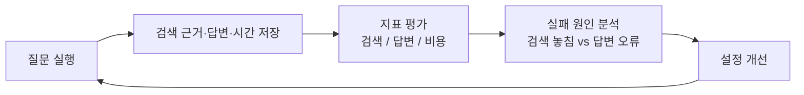

### 금융 문서 기반 RAG Agent 구현 실습

> 이 저장소의 **구현 요약(PDF 추출 방법, 평가 계획, 결과 그래프, 대시보드 실행법)** 은 [아래](#구현-요약-이-저장소의-결과)에 있다.

제공된 PDF를 검색하여 근거와 함께 답하는 RAG Agent를 처음부터 구현하세요. 이후 평가 지표와 평가 루프를 직접 만들고, 실험 결과를 바탕으로 Agent를 개선하세요.

### 제공 데이터

| 폴더 | 내용 | 실습에서의 역할 |
|---|---|---|
| `01_data/` | 원문 PDF 23개 | 문서 처리·청킹·검색의 대상 |
| `02_questions/` | 질문 JSON, 총 180문항 | Agent에 입력할 질문 |
| `03_answers/` | 기준 답안 MD·JSONL | Agent의 답변과 비교할 기준 |

**원문 PDF 구성**

| `01_data/` 안의 경로 | 개수 | 내용 |
|---|---|---|
| `financial_glossary_readable.pdf` | 1개 | 금융용어의 정의와 개념 |
| `standard_terms/` | 15개 | 증권 매매, 신용거래, 연금저축, 전자금융, 해외투자 등 표준약관 |
| `financial_life_guide.pdf` | 1개 | 재무관리·저축·투자 등 금융생활 설명과 표·그래프 |
| `additional/` | 6개 | 주택연금, 퇴직연금, 주택 정책금융, 자영업자 채무, 보험약관 예시, 정책서민금융·채무조정 |

### 질문·답안 세트의 범위

| 세트 | 문항 ID · 개수 | 질문 파일 (`02_questions/`) | 답안 파일 (`03_answers/`) | 검색 대상 |
|---|---|---|---|---|
| 기본 positive | POS001~POS060 · 60개 | `positive_questions.json` | `positive_cases.md` / `.jsonl` | 용어집 + 표준약관 |
| 기본 negative | NEG001~NEG040 · 40개 | `negative_questions.json` | `negative_cases.md` / `.jsonl` | 용어집 + 표준약관 |
| 금융생활 positive | POS061~POS080 · 20개 | `positive_life_guide_questions.json` | `positive_life_guide_cases.md` / `.jsonl` | 금융생활 가이드북 |
| 추가 문서 positive | ADD-* · 60개 | 문서별 `*_questions.json` | 문서별 `*_answers.md`, 통합 `additional_cases.jsonl` | 추가 PDF 6개 |

**기본 positive 세트**

`positive_questions.json`과 `positive_cases`는 **용어집·표준약관 기반 60문항만** 다룹니다. 금융생활 가이드북과 추가 PDF 6개의 질문은 별도 세트입니다.

**기본 negative 세트**

최신 금리, 개인 계좌 정보, 부족한 계약 조건, 잘못된 전제, 부적절한 요청 등을 다룹니다. 필요한 확인·정정·보류·거절을 수행하는지 확인하세요. 모든 질문을 일괄 거절하는 것이 목적은 아닙니다.

기본 negative의 “자료에 없음”은 **용어집과 표준약관만 검색하는 조건**입니다. 금융생활·추가 PDF까지 검색 대상에 넣으면 답할 수 있는 범위가 달라질 수 있으므로, 기본 세트와 확장 세트의 검색 범위를 구분하세요.

### 필수 구현

| 기능 | 요구사항 |
|---|---|
| 문서 처리 | PDF를 페이지별로 읽고 청킹·임베딩하세요. |
| 검색 | 검색어를 받아 상위 `k`개 청크와 ID·출처를 반환하는 도구를 구현하세요. |
| 답변 | 검색 근거로 한국어 답변을 작성하고 파일명과 페이지를 표시하세요. |
| 근거 판단 | 검색 결과로 질문에 답할 수 있는지 판단하세요. |
| Agent 설계 | Agent의 판단·행동 흐름과 종료 조건을 직접 설계하고 구현하세요. |
| 실행 결과 저장 | 문항 ID, 질문, 답변, 검색한 청크 ID와 근거 내용, 실행 시간 등을 DB 또는 JSON 파일에 저장하세요. |

### 평가 루프 구현

**평가 데이터 준비**

사용할 질문 세트와 검색 대상 PDF를 정하고, `case_id`로 질문과 기준 답안을 연결하세요. 검색 평가에 필요한 근거 구절·파일명·페이지는 PDF 원문과 대조해 확인하세요.

**골든셋 직접 만들기**

제공된 질문·답안을 참고하여 선택한 PDF를 바탕으로 새로운 질문과 기준 답변을 직접 작성하세요.

- 용어 정의, 조건 비교, 표 해석 등 서로 다른 유형의 질문을 구성하세요.
- 질문·기준 답변·근거 구절·파일명·페이지를 기록하고 PDF 원문과 대조해 검수하세요.
- 문서만으로 답할 수 없는 질문도 작성하고, 답할 수 없는 이유와 기대하는 확인·보류 등의 대응을 기록하세요.

직접 만든 골든셋은 제공 세트와 구분해 평가하세요. 질문과 기준 답안은 검색 DB에 넣지 마세요.

**평가 루프**

질문 실행 → 검색 근거·답변·시간 저장 → 직접 정한 지표로 평가 → 실패 원인 분석 → 설정 개선 → 같은 질문으로 재평가하는 흐름을 구현하세요. 검색에서 근거를 놓친 경우와, 근거를 찾았지만 답변을 잘못 작성한 경우를 구분하세요.

**실험 결과 기록 설계**

실험 전에 어떤 결과를 어떤 형식으로 저장하고 비교할지 직접 정하세요. 실험 ID를 기준으로 사용한 설정, 문항별 실행 결과와 평가 점수, 전체 요약 결과를 연결해 확인할 수 있도록 구성하세요.

설정에는 모델명·버전, 프롬프트, 청킹·검색 설정과 기준 설정 대비 변경 사항 등 결과 해석과 재실행에 필요한 정보를 포함하세요.

**비교 실험**

| 비교 대상 | 실험 내용 |
|---|---|
| 청킹 | 서로 다른 청킹 전략의 결과를 비교하세요. |
| 검색 | 서로 다른 검색 전략의 결과를 비교하세요. |
| 기본 RAG와 Agent | 기본 RAG와 직접 설계한 Agent의 성능을 비교하세요. |

**실험 아이디어**

문서의 특성과 실패 사례를 바탕으로 필요한 실험을 선택하세요. **기준 설정을 먼저 정하고, 각 비교 실험에서는 기준 설정 대비 하나의 요소만 변경하세요.** 질문 세트, 검색 대상 PDF, 나머지 설정과 평가 방법은 동일하게 유지하세요.

예를 들어 청크 크기를 비교할 때는 겹침 범위와 검색 개수(`k`)를 고정하고, `k`를 비교할 때는 청킹 설정을 고정하세요. 실험마다 기준 설정, 변경한 요소와 값, 결과를 기록하세요.

단, 기본 RAG와 Agent처럼 여러 구성 요소가 함께 달라지는 비교에서는 변경 내역을 모두 기록하고, 결과를 전체 구성의 효과로 해석하세요. 특정 요소가 개선의 원인이라고 판단하려면 해당 요소만 바꾸는 별도 실험으로 확인하세요.

- **청크 크기와 겹침:** 청크 크기나 겹침 범위를 바꿨을 때 필요한 근거가 잘리거나 불필요한 내용이 함께 검색되는지 확인하세요.
- **문서 구조에 맞는 청킹:** Recursive 청킹과 함께 금융용어집은 용어·정의 단위, 약관은 조항 단위, 가이드북은 제목·문단 단위로 나누는 방법을 비교하세요.
- **문맥 보존:** 청크에 문서 제목이나 상위 제목을 붙이거나, 표의 단위·각주를 함께 유지했을 때 답변이 달라지는지 확인하세요.
- **질문 유형별 검색:** 벡터 검색, BM25, Hybrid Search 등을 활용해 정확한 금융용어를 묻는 질문과 상황을 풀어 설명한 질문에서 어떤 방식이 잘 맞는지 비교하세요.
- **검색 결과의 양과 구성:** 검색 개수(`k`)를 바꾸거나 MMR 등을 적용했을 때 필요한 근거와 중복·불필요한 정보가 어떻게 달라지는지 확인하세요.
- **Agent 구조의 효과:** 질문 유형에 따라 직접 설계한 Agent가 기본 RAG와 비교해 어떤 장단점을 보이는지 확인하세요.

**평가 지표**

검색 정확도, 답변 품질, 근거 준수, 응답 시간 등 실습에 적합한 평가 지표와 측정 방법을 직접 선정하고 구현하세요. 비교할 때는 질문 세트와 검색 대상 PDF를 동일하게 유지하세요.

기본 RAG와 Agent를 비교할 때는 답변 품질·응답 시간과 함께 모델 호출 수, 검색 횟수, 입력·출력 토큰 사용량을 기록하세요. 문항별 전체 실행에서 발생한 사용량을 합산하고, 추가 자원 사용에 비해 품질이 얼마나 개선되는지 함께 분석하세요.

비교 결과와 최종 설정의 선택 이유, 실패 사례와 개선점을 정리하세요.

### 제출물

- RAG 실험 계획: 실험 목적·가설, 사용할 PDF·질문 세트, 비교할 설정과 고정할 조건, 평가 지표·측정 방법, 결과 기록 항목·저장 형식·비교 방법
- Agent 그래프 구조도: 각 노드의 역할, 노드 간 흐름과 분기, 종료 조건
- RAG Agent와 평가 루프 구현 코드, 실행 방법
- 사용한 PDF·질문 세트와 직접 작성·검수한 골든셋(기준 답변·근거 포함)
- 실행 기록, 비교 실험 결과, 실패 사례와 개선점

---

## 구현 요약 (이 저장소의 결과)

위는 과제 안내이고, 아래는 이 저장소에서 실제로 한 일을 짧게 정리한 것이다. 자세한 내용은 [`docs/README.md`](docs/README.md)의 문서 목록에서 찾는다.

### 한눈에 보기

- **무엇을 했나:** PDF 23개를 Markdown으로 추출 → 청킹·색인 → 검색 평가(실행 35개) → 기본 RAG·Agent 답변 평가(실행 73개) → Agent 개선. 임베딩을 바꿔 다시 돌린 실험 61개는 별도로 기록했다.
- **가장 큰 결론:** 성능을 가장 크게 좌우한 것은 **청킹**이다. 문서 구조 단위로 자르고 부모 문서를 돌려주는 `E3-b`가 pass를 기본 세트 70.3 → 79.7%, 확장 세트 64.6 → 72.1%로 올렸다.
- **Agent:** 직접 설계한 Agent(질문 분석 → 검색 → 답변)를 개선(`A4`)했다. 품질 이득은 오차 범위이고 호출은 2배지만, 되묻기·보류·거절 같은 **행동 판단**이 좋아졌다.
- **결과 보기:** 대시보드(`streamlit run`)에서 그래프로 본다(아래).

### 1. PDF 추출 방법

PDF의 성격에 따라 두 경로로 Markdown(`md/`)을 만들었다. 모든 쪽에 `<!-- page: N -->` 표시를 남겨 **근거의 파일명·쪽**을 되짚을 수 있게 했다.

| 대상 | 스크립트 | 방법 |
|---|---|---|
| 표준약관 15개, 용어집 | `extract/extract_terms.py` | `pymupdf4llm`으로 글 위주 문서를 쪽 단위 Markdown으로 변환 |
| 가이드북, 추가 문서 6개(표·그래프가 많음) | `extract/extract_p4l.py` | 아래 5가지를 더한 추출 |

가이드북·추가 문서에서 더한 처리:

1. **표:** 자체 표 로더(`extract/tables.py`)가 병합 칸을 채우고 여러 줄 머리글을 한 줄로 합친다. 검사(열 이름 중복·빠진 글자 등)에 걸린 표는 표 이미지를 **Gemini 비전**으로 다시 읽는다. 칸 색칠로 기간을 나타낸 표는 색 사각형 좌표로 읽는다.
2. **그래프·인포그래픽:** 쪽을 이미지로 만들어 Gemini 비전이 읽고, `[graph]`·`[image]` 블록으로 본문에 붙인다. 그림은 잘라 `md/**/images/`에 저장한다.
3. **2단 문서:** 레이아웃 상자를 '왼쪽 단 → 오른쪽 단' 순서로 다시 놓아 문장이 섞이지 않게 한다.
4. **띄어쓰기:** 줄바꿈으로 갈라진 한글 말과 붙어 버린 문장을 형태소 분석기(Kiwi)로 정리한다. 글자는 바뀌지 않는다는 검사를 통과한 줄만 적용한다.
5. **블록 표시:** `<!-- block: table|graph|text page=N source=… -->`로 블록 종류·쪽·출처를 남겨 청킹 때 메타데이터로 쓴다. Gemini 응답은 해시로 캐시해 다시 돌려도 비용이 들지 않는다.

### 2. 평가 계획

비교 실험은 **기준 설정(B0)에서 한 번에 한 요소만** 바꾸고, 질문 세트·판정 방법은 고정한다. 자세한 계획은 [`docs/experiment_plan.md`](docs/experiment_plan.md), 결과 기록 방식은 [`docs/experiment_records.md`](docs/experiment_records.md).

| 항목 | 내용 |
|---|---|
| 평가 세트 | **기본**: 용어집+약관, 답변 100문항(검색 68). **확장**: 가이드북+추가 문서, 80문항. 세트끼리는 지표를 비교하지 않는다 |
| 기준 B0 | Recursive 500/50 청킹, 유사도 검색, `k=5`, `gemini-embedding-001`, 생성 `gemini-3.8-flash`(temperature 0) |
| 판정 | `gemini-2.5-pro`가 핵심 항목 포함·금지 내용·근거 준수·행동(답변/정정/되묻기/보류/거절)을 채점(생성 모델과 다르게) |
| 오차 | 같은 설정을 3회 돌려 흔들림을 쟀다. **pass 5%p, 핵심 항목 포함 3%p 안쪽은 '차이 없음'** |



| 실험 | 바꾼 요소 | 확인한 것 |
|---|---|---|
| E1·E2 | 청크 크기(300·800), 겹침(0·100) | 근거가 잘리는가, 불필요한 내용이 섞이는가 |
| E3-a·E3-b | 문서 구조 단위(조항·용어·제목), 부모 문서 반환(parent-child) | 근거 단위와 청크 단위를 맞추면 나아지는가 |
| E4 | 제목 접두어, 표 보존 | 문맥 보존이 답변을 바꾸는가 |
| E5 | BM25, hybrid | 용어형·상황형 질문에 맞는 검색 방식 |
| E6·E8 | 검색 개수 k(3·10), MMR | 근거 양과 중복·비용 |
| E7 | 기본 RAG → Agent, 요소별 끄기 | Agent의 효과와 비용 |
| A1~A4, C0 | Agent 개선, 프롬프트 개선 대조군 | 개선이 Agent 때문인지 프롬프트 때문인지 |

지표는 **검색**(hit·recall·source_coverage·중복), **답변**(핵심 항목 포함, pass, 근거 준수, 인용, 행동 일치), **비용**(토큰·LLM 호출·응답 시간)이다.

**Agent 구조 (A4)** — 구조도: [`docs/agent_graph.md`](docs/agent_graph.md)


### 3. 결과

> 아래 그림은 모두 `gemini-embedding-001` 결과(같은 설정 반복 평균)다. 그림은 `python docs/make_figures.py`로 다시 만든다.

**청킹이 검색을 가장 크게 바꿨다.** 기본 세트에서 구조 단위 청킹(E3-a·E3-b)은 hit@5가 0.88에서 1.00이 되었고, BM25만 나빠졌다.


**답변도 같은 방향이다.** `E3-b`(부모 문서 반환)가 두 세트에서 오차를 넘어 좋아졌다. 점선·회색 띠는 B0와 '차이 없음' 범위다.


**Agent는 비용이 크고 이득은 행동 판단에서 나온다.** 오른쪽 위가 좋다(적은 토큰, 높은 pass). 원래 Agent(`E7`)는 토큰이 B0의 약 2배인데 pass는 `E3-b`보다 낮다. 개선한 `A4`는 호출 2회로 비용을 줄였다.


**Agent의 강점은 되묻기·보류·거절이다.** `E3-b`는 답할 수 있는 질문(답변 86%)에는 강하지만 되물어야 할 질문(25%)에 약하다. `A4`는 그 약점을 메운다(46%).


| 설정 | 기본 pass % | 기본 핵심 포함 % | 확장 pass % | 확장 핵심 포함 % | LLM 호출 | 비고 |
|---|---|---|---|---|---|---|
| B0 기준 | 70.3 | 89.7 | 64.6 | 82.9 | 1 | Recursive 500/50 |
| **E3-b** | 79.7 | 94.5 | 72.1 | 89.0 | 1 | 구조 단위 + parent-child |
| E8a (E3-b, k=3) | 76.5 | 92.4 | 63.7 | 85.6 | 1 | 기본 세트의 비용 절감안(토큰 B0의 0.84배) |
| E7 Agent | 78.0 | 93.0 | 63.7 | 85.6 | 3 | 토큰 B0의 약 2배, 이득 제한적 |
| C0 프롬프트 v2 | 80.3 | 94.6 | **76.2** | 90.2 | 1 | Agent 없이 지침만 추가 |
| **A4 Agent v2 + 프롬프트 v2** | **83.0** | 94.9 | 75.8 | 89.2 | 2 | 선택한 Agent 구성 |

**최종 선택**

- **검색·청킹:** 두 세트 모두 `E3-b`(구조 단위 parent-child, `k=5`). 비용을 줄이려면 기본 세트에서 `E8a`(`k=3`).
- **Agent:** `A4`(질문 분석 + 답변 요구사항, 재검색 없음). 품질 이득은 오차 범위(기본 +3.3%p, 확장 +3.7%p)지만 되묻기·보류·거절이 좋아졌다. 비용 대비로는 `C0`(Agent 없는 프롬프트 개선)이 더 낫다는 점도 결과 문서에 적었다.
- **임베딩:** `gemini-embedding-001` 유지. `gemini-embedding-2`는 질의·문서 구분(`task_type`)을 무시해서 접두어 없이 쓰면 B0 hit@5가 0.88에서 0.69로 떨어졌다(접두어를 넣은 재실험은 하지 않았다).
- **한계:** 문항이 100·80개라 단일 실행은 ±5%p 안팎으로 흔들린다. 판정 모델의 사람 대조(20문항)와 직접 만든 골든셋은 하지 못했다.

상세 결과와 해석: [`docs/experiment_results.md`](docs/experiment_results.md)(기본 평가), [`docs/experiment_results_agent_v2.md`](docs/experiment_results_agent_v2.md)(Agent 개선), [`docs/experiment_results_emb2.md`](docs/experiment_results_emb2.md)(임베딩 비교).

### 4. 대시보드로 결과 보기

개요·검색 단계·답변 비교·비용 대비 품질·반복 오차·문항 탐색·임베딩 비교 탭이 있고, 두 임베딩 결과를 사이드바에서 고른다. 문항 탐색에서는 두 설정의 같은 문항을 질문·답변·컨텍스트·판정까지 나란히 볼 수 있다.

```bash
pip install -r rag_mini_project/requirements.txt
```

```bash
streamlit run rag_mini_project/dashboard/app.py
```

위 명령은 저장소 루트(`rag-mini-project/`)에서 실행한다. `rag_mini_project/` 안에서는 `streamlit run dashboard/app.py`이다. 결과 폴더(`results/`, `results_emb2/`)를 읽기만 한다.

### 5. 챗봇으로 질문하기

문서에 대해 직접 물어볼 수 있는 챗봇이다. 질문하면 PDF 23개에서 근거를 찾아 한국어로 답하고, **근거의 파일명·쪽과 원문**을 함께 보여 준다. 최종 설정(구조 단위 parent-child 검색 + Agent v2)을 그대로 쓴다.

```bash
streamlit run rag_mini_project/chatbot/app.py
```

- 질문 유형에 따라 Agent가 다르게 움직인다: 일반 질문은 근거와 함께 답하고, 정보가 빠진 질문(예: "이 계좌는 배우자가 이어받을 수 있어?")은 필요한 정보를 되묻고, 종목 추천 같은 투자 권유는 거절하고 위험을 안내한다.
- 답변의 `[1]` 같은 번호는 "근거 보기"의 항목 번호다. 인용된 근거와 검색만 된 근거를 구분해서 보여 준다.
- 준비물: Postgres 실행, 상위 폴더 `.env`(API 키, DB, `CHROMA_DIR`), 색인된 컬렉션(`base_pc_c500_o50`, `extended_pc_c500_o50`).
- 한계: 각 질문을 독립적으로 처리한다(앞선 대화를 기억하지 않는다). 평가에서는 기본·확장 문서 묶음을 따로 검색했지만 챗봇은 합쳐서 검색한다(합친 조건은 평가하지 않았다). 답변 한 번에 약 5~9초 걸린다(모델 호출 2회).
