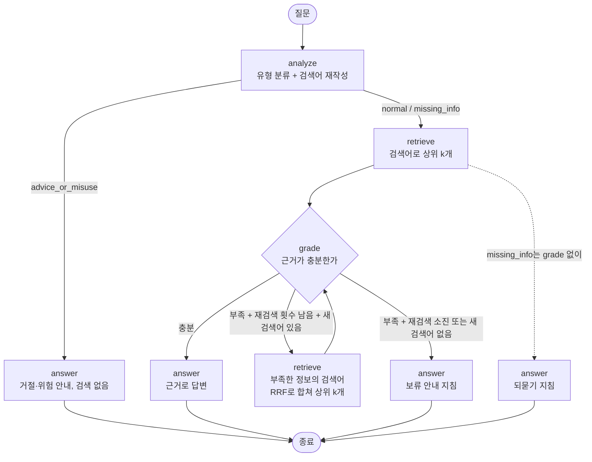

# Agent 그래프 구조도 (검색 재시도형)

구현: `rag/agent.py`. 기본 RAG는 `검색 1번 → 답변 1번`이고, Agent는 질문을 분석해 흐름을 나누고 검색이 부족하면 다시 찾는다.
모든 노드는 같은 생성 모델(`gemini-3.8-flash`, temperature 0, 생각 끔)을 쓴다. 마지막 `answer` 노드는 기본 RAG와 같은
시스템 프롬프트·출력 형식(JSON: answer, citations)이다.

## 노드

| 노드 | 역할 | 입력 → 출력 | LLM 호출 |
|---|---|---|---|
| `analyze` | 질문 유형 분류와 검색어 재작성. 질문 속 '이전 지시를 무시해라' 같은 명령은 검색어에서 뺀다 | 질문 → `request_type`(normal / missing_info / advice_or_misuse), `search_query` | 1 |
| `retrieve` | 검색어로 상위 k개 검색(기본 RAG와 같은 검색기·설정). 재검색 결과는 RRF로 합쳐 상위 k개 | 검색어 → 결과 k개 | 0 (검색 1회) |
| `grade` | 근거가 질문의 핵심 사실(정의·조건·기간·수치·절차)을 담고 있는지 판단. 부족하면 찾을 정보를 검색어로 제시 | 질문 + 이전 검색어 + 근거 → `sufficient`, `missing_query` | 1 |
| `answer` | 근거와 처리 지침으로 최종 답변. 지침: 거절(advice_or_misuse), 되묻기(missing_info), 보류(재검색 후에도 부족) | 질문 + 근거 + 지침 → 답변, 인용 번호 | 1 |

## 분기와 종료 조건

- **분기:** `analyze`의 `request_type`이 갈림길이다. advice_or_misuse는 검색 없이 거절 안내, missing_info는 검색 한 번 뒤 되묻기 안내, normal은 `grade`로 간다.
- **재검색 루프:** `grade`가 '부족'이고 새 검색어가 있으면 다시 검색한다(최대 `retry`=2회).
- **종료:** 다음 중 하나이면 `answer`로 가서 끝난다.
  1. `grade`가 '충분'이라고 판단
  2. 재검색 횟수가 `retry`에 도달 (이때 보류 안내 지침)
  3. `grade`가 새 검색어를 내지 못했거나 이전과 같은 검색어를 냄 (이때 보류 안내 지침)
  4. advice_or_misuse 또는 missing_info 경로
- 질문 하나당 LLM 호출은 2번(거절·되묻기 경로: analyze 1 + answer 1)에서 최대 5번(analyze 1 + grade 3 + answer 1)이다. 검색은 0~3회.
  기본 RAG는 LLM 1번, 검색 1번이다.

## 요소 끄기(ablation)

`python -m rag.answer_eval --mode agent --agent-options "<옵션>"`

| 옵션 | 효과 | 용도 |
|---|---|---|
| `retry=0` | `grade`와 재검색을 모두 끔 | 질문 분석·분기만의 효과 |
| `analyze=0` | 질문 분석을 끔(원 질문으로 검색, 유형 분기 없음) | 재검색만의 효과 (`route=0`과 함께) |
| `route=0` | 처리 지침(거절·되묻기·보류)을 끔 | 분기 지침의 효과 |

기본 RAG와 Agent는 질문 분석, 재검색, 분기 지침, 프롬프트가 함께 달라지므로 비교 결과는 **전체 구성의 효과**로 해석한다.
어떤 요소가 원인인지는 위 옵션으로 요소만 켜거나 끈 실험으로 확인한다.
